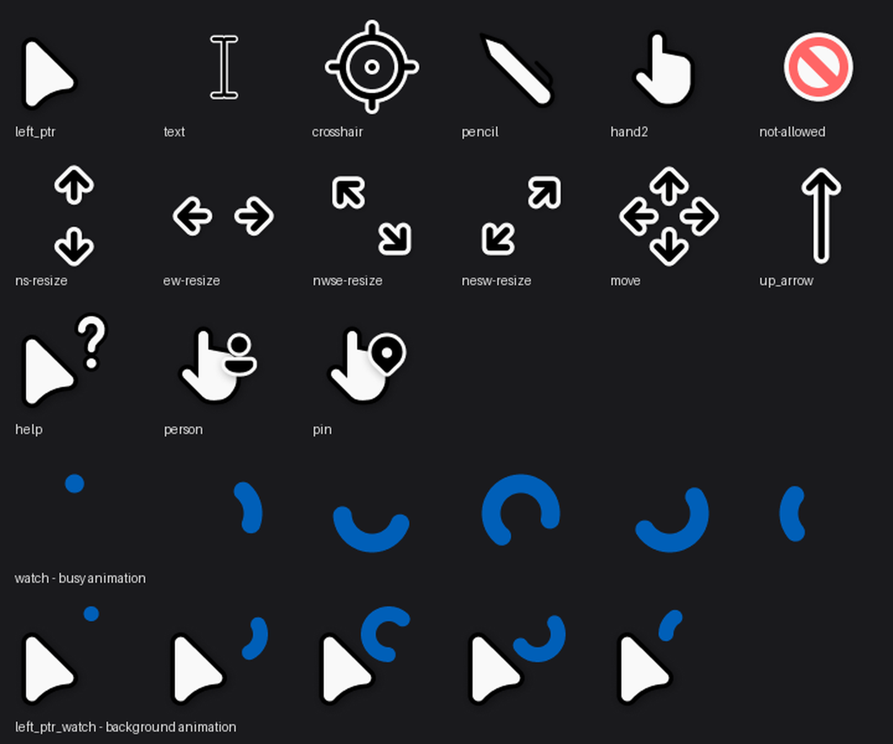

# W11 鼠标指针 · Linux (Xcursor) 版

Windows 11 风格的鼠标指针在 Linux 上的移植：把 Windows 指针包里的 `.cur` / `.ani`
转换成标准 **Xcursor** 主题，niri / 任意 Wayland 合成器 / X11 都能直接用。

- 白色箭头 + 黑色描边（light 版本），32 / 48 / 64 / 96 四档尺寸
- 转圈动画保留原版节奏（37 帧，每帧 33 ms）
- 自带 98 个光标名（含 `default`、`text`、`pointer`、`progress`、`col-resize`、
  `nwse-resize` 等 Wayland CSS 名称与 X11 传统名称别名）



## 来源与致谢

原始指针美术来自 **Jepri Creations** 的 Windows 11 指针包：

> `W11 Cursors Light HDPI v2.2 default By Jepri Creations`

（摘自源包内每个配色目录下的 `Install.inf`。源包中没有提供作者网址，也没有
附带许可协议说明。）

本仓库只做了**格式转换**（Windows `.cur` / `.ani` → Xcursor）与渲染修正，
没有改动原作者的造型、配色和动画节奏。

## 仓库内容

```
theme/W11-Light-default/   可直接使用的 Xcursor 主题（98 个条目）
tools/xcursor.py           .cur / .ani 解析 + Xcursor 写出
tools/build_theme.py       按「明暗 / 尺寸 / 配色」组装主题
install.sh                 一键安装
preview.png                已安装样式的各光标预览
colors.png                 11 种配色（转圈动画颜色）对照
alpha-fix.png              alpha 格式修复前后对比
```

## 安装

```bash
git clone https://github.com/FragrantHaze/w11-cursors-linux.git
cd w11-cursors-linux
./install.sh          # 可加光标尺寸参数，默认 24：./install.sh 32
```

脚本会：

1. 把 `theme/W11-Light-default` 复制到 `~/.local/share/icons/`
2. 执行 `gsettings set org.gnome.desktop.interface cursor-theme W11-Light-default`
   （GTK / libadwaita 应用走这个设置）

niri 用户再把下面这段加进 `~/.config/niri/config.kdl`：

```kdl
cursor {
    xcursor-theme "W11-Light-default"
    xcursor-size 24
}
```

然后重新登录一次（或重启对应应用）。Wayland 合成器会把已加载的光标图像
缓存住，换主题后不重新登录时，部分已经开着的窗口可能还显示旧光标。

## 换配色

`colors.png` 里是 11 种配色，差异只在「转圈」动画（工作/等待光标）的颜色上，
箭头本体不变：

`01. default`、`02. classic`、`03. amber`、`04. green`、`05. indigo`、
`06. red`、`07. squid`、`08. purple`、`09. candy`、`10. sunset`、
`dark purple - pippouz request`

重新生成需要原始 Windows 指针包。把包放到默认路径，或用 `CURSOR_PACK`
环境变量指定：

```bash
CURSOR_PACK=/path/to/鼠标指针 python3 tools/build_theme.py light/regular "03. amber" W11-Light-amber
```

第一个参数是明暗/尺寸（`dark/regular`、`dark/small`、`light/regular`、
`light/small`，其中 `small` 是同一画布内图形更小的版本），第二个是配色目录，
第三个是生成的 Xcursor 主题名。

## 技术细节

- **Xcursor 用的是预乘 alpha**。这是转换时最容易踩的坑：Xcursor 文件、X11 的
  ARGB 光标、`wl_shm` 的 `ARGB8888` 都要求像素是预乘的。若写成直通
  （straight）alpha，合成器按 `dst = src + bg * (1 - a)` 混合时会把低 alpha
  像素的 RGB 原样加到背景上，指针四周就会出现一圈发亮噪点——`alpha-fix.png`
  左侧就是这个问题。`tools/xcursor.py` 现在会在打包前做
  `rgb * alpha / 255`（四舍五入）。
- **清理源图杂点**：原始 96px 帧里散落着 `RGB=255, alpha=1` 的孤立像素，
  转换时按连通域剔除，避免任何按直通 alpha 渲染的软件把它们显示成白色麻点。
- **动画**：Xcursor 对每个尺寸连续存放 37 帧、每帧 33 ms 延迟，libXcursor 会
  自动识别为动画；静态光标 delay 为 0。
- **一处素材缺陷**：`light/regular/01. default/busy.ani` 在原包里只有 32px 帧，
  与 dark 包同帧逐像素一致，因此大尺寸借用了 `dark/regular/01. default` 的
  同一段动画（不是插值放大）。

## 许可

原始指针美术版权归 **Jepri Creations** 所有，本仓库不主张其权利；如需商用或
再次分发美术素材，请先与原作者确认。转换脚本（`tools/`、`install.sh`）以
[MIT](LICENSE) 许可发布。
